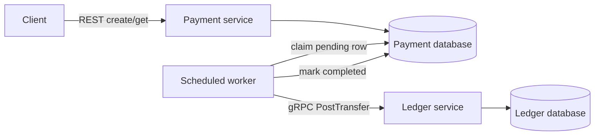

# Payment Platform

A simulated payment platform for studying transaction correctness, concurrency,
and recovery. Java 21 / Spring Boot 3.5, REST, gRPC, and PostgreSQL 17.
No real money is moved.

The MVP creates and retrieves payments, prevents duplicate requests, posts balanced
immutable ledger entries, and recovers pending work after outages and lost responses.
This is a recording system: account identifiers need no provisioning and negative
balances are permitted. Available funds and concurrent overspending checks belong
to the [next milestone](docs/roadmap.md).

## Run locally

Install Docker with Compose. Host Java and Maven are optional for running the stack.

```sh
docker compose up --build -d --wait
python3 scripts/smoke.py
# Exercise a ledger outage and a payment-service restart as well:
python3 scripts/smoke.py --recovery
```

The API is at `http://localhost:8080`. Override the host port with
`PAYMENT_PORT=8081 docker compose up --build -d --wait`; pass
`--base-url http://localhost:8081` to the smoke script. PostgreSQL and gRPC are
internal to the Compose network. Services run as a non-root user. Compose health
checks verify open service ports; `/actuator/health` additionally checks the payment
database, but deliberately does not require the ledger to be available for acceptance.

```sh
curl -i http://localhost:8080/payments \
  -H 'Content-Type: application/json' \
  -H 'Idempotency-Key: example-payment-001' \
  -d '{"sourceAccount":"alice","destinationAccount":"merchant","amountMinor":2500,"currency":"USD"}'

curl http://localhost:8080/payments/REPLACE_WITH_RETURNED_UUID
```

`amountMinor: 2500` means USD 25.00. The API accepts USD only and integer amounts
from 1 through 1,000,000,000,000 minor units. Account IDs must be nonblank, distinct,
and at most 100 characters. Names are case-sensitive and preserved as supplied.
The required `Idempotency-Key` supports up to 200 printable ASCII characters;
use a UUID or another opaque token without surrounding whitespace. Keys are global
in this unauthenticated sandbox and retained indefinitely.

| Request | Response |
| --- | --- |
| New `POST /payments` | `202`, resource and `Location` header |
| Same key and same validated fields | `200`, same payment ID and current status |
| Same key with different fields | `409 IDEMPOTENCY_CONFLICT` |
| `GET /payments/{id}` | `200`, or `404 PAYMENT_NOT_FOUND` |
| Invalid fields, JSON, key, or UUID | `400 INVALID_REQUEST` |
| Database unavailable | `503 SERVICE_UNAVAILABLE` |

```json
{
  "id": "594a5ce0-7c7b-4fe0-9ac1-932cf176725f",
  "sourceAccount": "alice",
  "destinationAccount": "merchant",
  "amountMinor": 2500,
  "currency": "USD",
  "status": "PENDING",
  "createdAt": "2026-11-09T05:00:00Z",
  "completedAt": null
}
```

Creation acknowledges durable acceptance, not completion. Poll the resource until
`status` is `COMPLETED`. Replays return the current resource, so the response body
can change as processing progresses.

## Design



Each service owns a separate database and role. A single local PostgreSQL container
hosts both. Flyway applies migrations on startup in service-specific locations.
The protobuf contract lives in `ledger-contract`; it exposes `PostTransfer` and
`GetTransfer`. gRPC uses plaintext inside the local network; a production deployment
would need authentication and transport security.

**Acceptance:** a unique PostgreSQL constraint arbitrates concurrent idempotency
keys. `INSERT ... ON CONFLICT DO NOTHING` followed by a separate READ COMMITTED
query sees the winning request and compares its fields. No process-local lock or
in-memory idempotency cache is involved.

**Processing:** the committed PENDING row is also the durable work queue. A worker
claims one due row with `FOR UPDATE SKIP LOCKED`, calls gRPC with a two-second
deadline, and commits completion. Each batch handles at most ten rows, with a
250 ms delay between batches. The default single scheduler uses one of ten database
connections, leaving capacity for the API. Multiple service instances can claim
different rows. Holding the row lock during the bounded RPC is a deliberate MVP
tradeoff; higher throughput could justify leases or a broker.

**Ledger:** one transaction inserts a unique journal keyed by payment ID and two
entries: source DEBIT and destination CREDIT, each for the same positive amount and
currency. Deferred database constraints reject missing, mismatched, or unbalanced
entries at commit. Update/delete triggers protect posted records from application
mutations. These are debit/credit recording conventions, not a full bank chart of
accounts. Database administrators can still alter schema or bypass protections.

**Recovery:** delivery is at least once; ledger effects occur once per payment ID.
This does not claim exactly-once delivery or a distributed transaction.

| Failure | Recovery |
| --- | --- |
| Payment service stops after accepting | Restarted worker reads the durable PENDING row |
| Ledger fails between entry inserts | Its transaction rolls back both journal and entries |
| Ledger commits but its response is lost | Retry finds and returns the same journal |
| Local completion write fails after ledger commits | Local transaction rolls back; retry reuses the journal |
| Ledger remains unavailable | Payment remains PENDING; persisted retry backoff grows from 1 to at most 60 seconds |

Retries have no maximum count in this increment. Internal contract errors such as
changed fields under an existing ledger ID are logged as errors and retained pending
for investigation. They are not mislabeled as a failed transfer after an ambiguous
outcome. `attempt_count`, `next_attempt_at`, and `last_error` are stored in the
payment database. No operator dashboard or alerting is implemented yet.

## Test and inspect

With Java 21, Maven 3.9+, and a running Docker daemon:

```sh
mvn -B -ntp verify
```

Testcontainers starts actual PostgreSQL instances. Tests cover 24 concurrent matching
and mismatching REST requests, concurrent ledger posting, validation, database
immutability and balance constraints, second-insert rollback, competing workers,
ledger outages, a lost response after ledger commit, and a reopened payment database
pool recovering durable work. Failure injection is confined to test fixtures.
The Compose recovery smoke test also restarts the real payment process.
GitHub Actions runs the Maven suites and the full Compose smoke test.

Inspect ledger records without exposing a PostgreSQL host port:

```sh
docker compose exec postgres psql -U ledger -d ledger \
  -c 'SELECT * FROM journals ORDER BY created_at DESC LIMIT 10'
docker compose exec postgres psql -U ledger -d ledger \
  -c 'SELECT * FROM entries ORDER BY payment_id, side'
docker compose logs -f payment ledger
```

`docker compose down` stops services and retains records. **Destructive reset:**
`docker compose down -v` removes the project's database volume and all simulated
payments. The SQL initialization runs only when that volume is first created.
The checked-in passwords are local simulation defaults. There is no authentication,
authorization, rate limiting, funding validation, or real processor integration.
