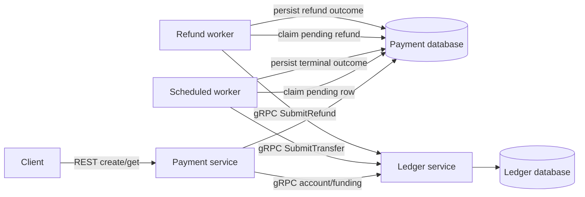

# Payment Platform

A simulated payment platform for studying transaction correctness, concurrency,
and recovery. Java 21 / Spring Boot 3.5, REST, gRPC, and PostgreSQL 17.
No real money is moved.

The platform creates accounts, funds them with simulated money, and processes
idempotent payments through a balanced immutable ledger. Account locks prevent
distinct concurrent payments from spending the same funds. Durable posting decisions
preserve both successful and rejected outcomes across retries and lost responses.
Full/partial refunds preserve the original payment and create balanced reversals;
posted account history is cursor-paginated. Merchant webhooks and reconciliation
are [later milestones](docs/roadmap.md).

## Run locally

Install Docker with Compose. Host Java and Maven are optional for running the stack.

```sh
docker compose up --build -d --wait
python3 scripts/smoke.py
# Exercise a ledger outage and a payment-service restart as well:
python3 scripts/smoke.py --recovery
```

The API is at `http://localhost:8080`. Override the host port with
`PAYMENT_PORT=8081 docker compose up --build -d --wait`; pass
`--base-url http://localhost:8081` to the smoke script. PostgreSQL and gRPC are
internal to the Compose network. Services run as a non-root user. Compose health
checks verify open service ports; `/actuator/health` additionally checks the payment
database, but deliberately does not require the ledger to be available for acceptance.

```sh
curl -i http://localhost:8080/accounts \
  -H 'Content-Type: application/json' \
  -d '{"accountId":"alice","currency":"USD"}'
curl -i http://localhost:8080/accounts \
  -H 'Content-Type: application/json' \
  -d '{"accountId":"merchant","currency":"USD"}'
curl -i http://localhost:8080/funding \
  -H 'Content-Type: application/json' \
  -H 'Idempotency-Key: example-funding-001' \
  -d '{"accountId":"alice","amountMinor":10000,"currency":"USD"}'

curl -i http://localhost:8080/payments \
  -H 'Content-Type: application/json' \
  -H 'Idempotency-Key: example-payment-001' \
  -d '{"sourceAccount":"alice","destinationAccount":"merchant","amountMinor":2500,"currency":"USD"}'

curl http://localhost:8080/payments/REPLACE_WITH_RETURNED_UUID
curl http://localhost:8080/accounts/alice

# After the payment reports COMPLETED; use its returned UUID:
curl -i http://localhost:8080/payments/REPLACE_WITH_RETURNED_UUID/refunds \
  -H 'Content-Type: application/json' \
  -H 'Idempotency-Key: example-refund-001' \
  -d '{"amountMinor":1000}'
curl http://localhost:8080/refunds/REPLACE_WITH_REFUND_UUID
curl 'http://localhost:8080/accounts/alice/transactions?limit=20'
```

`amountMinor: 2500` means USD 25.00. The API accepts USD only and integer amounts
from 1 through 1,000,000,000,000 minor units. Amounts must be JSON integers;
quoted numeric strings and fractional numbers return 400. Account IDs must be nonblank, distinct,
and at most 100 characters. Names are case-sensitive and preserved as supplied.
The required `Idempotency-Key` supports up to 200 printable ASCII characters;
use a UUID or another opaque token without surrounding whitespace. Keys are global
in this unauthenticated sandbox and retained indefinitely. Funding, payments and
refunds use separate key namespaces. The internal ID `__simulation_issuer__` is reserved.

| Request | Response |
| --- | --- |
| `POST /accounts` | `201` new or `200` for the same account ID; starts at zero |
| `GET /accounts/{accountId}` | `200` with exact integer `balanceMinor`, or `404 ACCOUNT_NOT_FOUND` |
| `GET /accounts?accountId=...` | Equivalent lookup supporting IDs containing slashes |
| `POST /funding` with a new key | `201`, immutable funding receipt |
| Funding replay / changed fields | `200` same receipt / `409 IDEMPOTENCY_CONFLICT` |
| Funding a missing account | `404 ACCOUNT_NOT_FOUND`; that key retains its rejected outcome |
| New `POST /payments` | `202`, resource and `Location` header |
| Same key and same validated fields | `200`, same payment ID and current status |
| Same key with different fields | `409 IDEMPOTENCY_CONFLICT` |
| `GET /payments/{id}` | `200`, or `404 PAYMENT_NOT_FOUND` |
| `POST /payments/{id}/refunds` | `202` new or `200` replay, refund resource and `Location` |
| Refund of a pending/rejected payment | `409 PAYMENT_NOT_COMPLETED`; no refund queued |
| `GET /refunds/{id}` | `200`, or `404 REFUND_NOT_FOUND` |
| `GET /accounts/{id}/transactions` | `200` posted movements, `items` and `nextCursor` |
| `GET /transactions?accountId=...` | History alias supporting opaque account IDs |
| Invalid fields, JSON, key, or UUID | `400 INVALID_REQUEST` |
| Database unavailable | `503 SERVICE_UNAVAILABLE` |
| Ledger unavailable for account/funding calls | `503 LEDGER_UNAVAILABLE`; retry the same operation/key |

```json
{
  "id": "594a5ce0-7c7b-4fe0-9ac1-932cf176725f",
  "sourceAccount": "alice",
  "destinationAccount": "merchant",
  "amountMinor": 2500,
  "currency": "USD",
  "status": "PENDING",
  "createdAt": "2026-11-09T05:00:00Z",
  "completedAt": null,
  "rejectedAt": null,
  "rejectionReason": null
}
```

Creation acknowledges durable acceptance. Poll until `status` is `COMPLETED` or
`REJECTED`. Rejections include `rejectedAt` and `rejectionReason`:
`INSUFFICIENT_FUNDS` or `ACCOUNT_NOT_FOUND`. Both are terminal; later funding or
account creation cannot change a rejected payment. A new attempt needs a new key.
Replays return the current resource, so a pending response can change as it resolves.

Funding is synchronous and idempotent: a timeout may occur after it commits, so
retry with the original key. It is an unrestricted simulation faucet, not a deposit
integration or proof that external money was received. Account/funding endpoints
require the ledger; payment acceptance can continue during a ledger outage.

## Refunds and history

Refunds use an explicit `amountMinor` and inherit the original payment's currency.
A full refund specifies its full amount; partial refunds can cumulatively reach
that amount. Acceptance is asynchronous: poll `/refunds/{id}` for `COMPLETED` or
`REJECTED`. The original payment stays `COMPLETED`; its journal is never edited.
Each completed refund creates a separate reversal linked to that payment.

The recipient needs sufficient available funds to return the money. Refund
rejection reasons are `INSUFFICIENT_FUNDS`, `REFUND_LIMIT_EXCEEDED`,
`PAYMENT_NOT_FOUND`, or `PAYMENT_NOT_REFUNDABLE`. Funding and refund journals cannot
themselves be refunded. A rejection is final under its original key, including
after later funding. A transport failure stays pending and retries the same refund
UUID. Refund acceptance remains available during a ledger outage for an already
completed local payment.

History lists **posted movements only**, including `PAYMENT`, `FUNDING` and `REFUND`.
Pending/rejected requests are available through their payment/refund resources.
Each history item includes its journal `transactionId`, `type`, `accountId`,
`counterparty`, `direction` (DEBIT/CREDIT), positive `amountMinor`, `currency`,
`createdAt`, and `originalPaymentId` for refunds (null otherwise).

Use `limit` from 1 to 100 (default 20). Pass the returned `nextCursor` unchanged for
the next page; null means the end. Cursors are versioned and account-bound, and
malformed or cross-account cursors return 400. Ordering is descending creation time
then journal UUID, with strict keyset boundaries handling equal timestamps. This
is a live view rather than a cross-request snapshot: refresh the first page to see
concurrent new commits. Existing immutable entries do not move between pages.

## Design



Each service owns a separate database and role. A single local PostgreSQL container
hosts both. Flyway applies migrations on startup in service-specific locations.
The protobuf contract lives in `ledger-contract`; it exposes account/funding RPCs
and typed `SubmitTransfer`/`SubmitRefund` outcomes, plus `ListTransactions`.
Legacy `PostTransfer`/`GetTransfer` remain
available; the former reports business rejection with `FAILED_PRECONDITION`.
gRPC uses plaintext inside the local network; a production deployment
would need authentication and transport security.

**Acceptance:** a unique PostgreSQL constraint arbitrates concurrent idempotency
keys. `INSERT ... ON CONFLICT DO NOTHING` followed by a separate READ COMMITTED
query sees the winning request and compares its fields. No process-local lock or
in-memory idempotency cache is involved.

**Processing:** the committed PENDING row is also the durable work queue. A worker
claims one due row with `FOR UPDATE SKIP LOCKED`, calls gRPC with a two-second
deadline, and commits completion or terminal rejection. Each batch handles at most ten rows, with a
250 ms delay between batches. The default single scheduler uses one of ten database
connections, leaving capacity for the API. Multiple service instances can claim
different rows. Refunds use their own durable queue and the same locking/retry
pattern. `PAYMENT_WORKER_ENABLED=false` disables both processors. Holding the row lock during the bounded RPC is a deliberate MVP
tradeoff; higher throughput could justify leases or a broker.

**Ledger:** one transaction inserts a unique journal keyed by payment ID and two
entries: source DEBIT and destination CREDIT, each for the same positive amount and
currency. Deferred database constraints reject missing, mismatched, or unbalanced
entries at commit. Update/delete triggers protect posted records from application
mutations. These are debit/credit recording conventions, not a full bank chart of
accounts. Database administrators can still alter schema or bypass protections.

**Recovery:** delivery is at least once; ledger effects occur once per payment ID.
This does not claim exactly-once delivery or a distributed transaction.

**Balances and concurrency:** the ledger owns provisioned USD accounts. Balances
are exact sums of immutable credits minus debits, using PostgreSQL numeric and Java
BigInteger; the gRPC representation is an integer string and REST returns an integer.
No mutable balance cache can drift from the journal. Funding records an issuer
debit and customer credit; only the internal simulation issuer may create new funds.
All funding and transfer paths lock both account rows in the same bytewise ID order
before checking funds and inserting entries. A separate READ COMMITTED balance query
then sees entries from any transaction that just released those locks. This follows
[PostgreSQL's lock-ordering guidance](https://www.postgresql.org/docs/17/explicit-locking.html#LOCKING-DEADLOCKS).
An index supports per-account balance aggregation; its cost grows with account history.
This is a correctness-first implementation, with no throughput benchmark claimed.

**Posting decisions:** a unique operation ID stores immutable request fields and
the final outcome. The decision and successful journal/entries commit atomically;
deferred constraints reject unfinished decisions, successful decisions without a
matching journal, and rejected decisions with a journal. Replaying a rejection
returns that same rejection even if funds or accounts have since become available.
Unknown or mismatched RPC results remain pending for investigation.

**Refund cap and reversal:** a refund first locks its original payment journal,
checks the sum of successful refunds, then takes the usual ordered account locks.
All refund paths follow that order; ordinary transfers/funding never acquire an
original-payment lock after account locks. This serializes concurrent refunds for
one payment without blocking unrelated originals. The refund decision, posting
decision and reversal entries commit together. Deferred constraints tie the refund
to a posted original transfer and verify its reversal direction, amount and outcome.
Rejected refunds consume no refundable amount and create no reversal entries.

| Failure | Recovery |
| --- | --- |
| Payment service stops after accepting | Restarted worker reads the durable PENDING row |
| Ledger fails between entry inserts | Its transaction rolls back both journal and entries |
| Ledger commits but its response is lost | Retry finds and returns the same journal |
| Rejection commits but its response is lost | Retry returns the same rejection, even after funding |
| Local completion write fails after ledger commits | Local transaction rolls back; retry reuses the journal |
| Ledger remains unavailable | Payment remains PENDING; persisted retry backoff grows from 1 to at most 60 seconds |

Retries have no maximum count in this increment. Internal contract errors such as
changed fields under an existing ledger ID are logged as errors and retained pending
for investigation. They are not mislabeled as a failed transfer after an ambiguous
outcome. `attempt_count`, `next_attempt_at`, and `last_error` are stored in the
payment database. No operator dashboard or alerting is implemented yet.

## Test and inspect

With Java 21, Maven 3.9+, and a running Docker daemon:

```sh
mvn -B -ntp verify
```

Testcontainers starts actual PostgreSQL instances. Tests cover 24 concurrent matching
and mismatching REST requests, concurrent ledger posting, validation, database
immutability and balance constraints, second-insert rollback, competing workers,
ledger outages, lost success/rejection/funding responses, and a reopened payment
database pool recovering durable work. A limited-balance test races 24 distinct
transfers: ten spend the available 5,000 minor units and fourteen are rejected.
Opposing transfers test lock ordering; V1 upgrade tests preserve legacy debt and
idempotency. Failure injection is confined to test fixtures.
The Compose smoke test checks funding, balances, terminal rejection, eight distinct
HTTP payments sharing a limited source, and a real payment-process restart during
a ledger outage. Refund tests race twenty distinct 100-unit refunds against a
1,000-unit original, yielding ten successes and ten limit rejections even with
extra merchant funds. Tests also cover lost refund success/rejection responses,
local completion rollback, opposing refund/transfer lock order, and immutable
decisions. History tests cover tied timestamps, account-bound malformed cursors,
page boundaries and refund links. The recovery smoke restarts the real process
separately for pending payments and refunds, then traverses history pages.
GitHub Actions runs the suites and full recovery smoke test.

Inspect ledger records without exposing a PostgreSQL host port:

```sh
docker compose exec postgres psql -U ledger -d ledger \
  -c 'SELECT * FROM journals ORDER BY created_at DESC LIMIT 10'
docker compose exec postgres psql -U ledger -d ledger \
  -c 'SELECT * FROM entries ORDER BY payment_id, side'
docker compose logs -f payment ledger
```

## Upgrade from the recording-only MVP

V2 migrations preserve existing journals and backfill accounts and successful
decisions. Legacy balances remain exactly as recorded, including negative balances
that v0.1 permitted. No automatic grants or synthetic entries erase that debt;
fund an indebted account enough to cover its debt before it can spend again.
Pending old payments now undergo the new account/funds checks and may be rejected.
Only IDs appearing in old posted entries are backfilled automatically; provision
other accounts explicitly. Migration stops with a clear error if old history used
the now-reserved issuer ID, rather than silently reinterpreting it.

For newly created accounts, spending cannot make the balance negative. Transfers
and funding always preserve a zero net sum across all ledger entries, including
the issuer. V3 adds refunds while preserving original journals; V4 corrects refund
decision namespace checks without rewriting V3. Successful V2 payments remain
refundable after upgrade. No spend reservations are implemented.

`docker compose down` stops services and retains records. **Destructive reset:**
`docker compose down -v` removes the project's database volume and all simulated
payments. The SQL initialization runs only when that volume is first created.
The checked-in passwords are local simulation defaults. There is no authentication,
authorization, rate limiting, or real processor integration.
